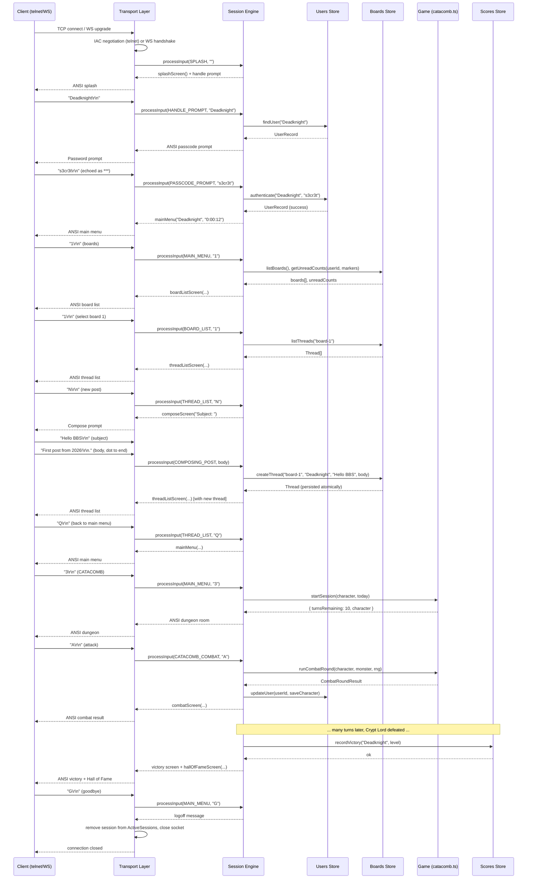

# DeadLine BBS — Technical Design

## 1. Architecture Overview

The system is organized into four horizontal layers. No layer may import from a layer above it.

```
┌─────────────────────────────────────────────────────────┐
│  Transports                                             │
│  src/server/telnet.ts   src/server/http.ts              │
│  src/server/ws-bridge.ts   src/telnet/negotiation.ts    │
│  src/telnet/ansi.ts                                     │
├─────────────────────────────────────────────────────────┤
│  Session Engine  (pure state machine, no I/O)           │
│  src/session/engine.ts   src/session/screens.ts         │
│  src/session/input.ts                                   │
├─────────────────────────────────────────────────────────┤
│  Business Logic / Stores                                │
│  src/boards/boards.ts   src/boards/store.ts             │
│  src/boards/search.ts   src/users/users.ts              │
│  src/game/catacomb.ts   src/game/scores.ts              │
│  src/files/filearea.ts                                  │
├─────────────────────────────────────────────────────────┤
│  Shared                                                 │
│  src/shared/types.ts   src/shared/validation.ts         │
│  src/shared/errors.ts                                   │
└─────────────────────────────────────────────────────────┘
```

**Key invariants**:
- Transport modules never contain session logic; they only move bytes.
- `engine.ts` is a pure state machine: `processInput(state, input) → { state, output }`. It never touches sockets, files, or timers directly.
- Store modules own all file I/O. No other module writes to `data/`.
- `catacomb.ts` is pure functions over explicit state; callers pass state in and receive new state back.

---

## 2. Component Design

### 2.1 src/shared/types.ts
Central type definitions shared across all layers. No runtime logic.

```typescript
// User record persisted in data/users.json
interface UserRecord {
  id: string;             // UUID
  handle: string;         // 2–20 chars, ANSI-stripped
  passwordHash: string;   // hex SHA-256(salt + passcode)
  salt: string;           // 16-byte random hex
  createdAt: string;      // ISO 8601
  lastLoginAt: string;    // ISO 8601
  readMarkers: Record<string, string>; // boardId → lastReadPostId
  gameCharacter: GameCharacter | null;
}

// Message board data
interface Board {
  id: string;
  name: string;
  description: string;
}

interface Post {
  id: string;             // UUID
  threadId: string;
  boardId: string;
  authorHandle: string;
  subject: string;        // max 72 chars
  body: string;           // max 4096 chars
  createdAt: string;      // ISO 8601
  isArchive: boolean;     // true for 1994 seed posts
}

interface Thread {
  id: string;
  boardId: string;
  subject: string;
  authorHandle: string;
  createdAt: string;
  posts: Post[];
}

// CATACOMB game state
interface GameCharacter {
  userId: string;
  hp: number;
  maxHp: number;
  attack: number;
  defense: number;
  level: number;
  xp: number;
  xpToNextLevel: number;
  gold: number;
  dungeonDepth: number;   // how deep the character has progressed
  turnsUsedToday: number;
  turnsResetDate: string; // ISO date YYYY-MM-DD
  isVictorious: boolean;
}

interface Monster {
  name: string;
  hp: number;
  attack: number;
  defense: number;
  xpReward: number;
  goldReward: number;
  isFinalBoss: boolean;
}

interface CombatResult {
  playerDamageDealt: number;
  monsterDamageDealt: number;
  monsterDefeated: boolean;
  playerDefeated: boolean;
  xpAwarded: number;
  goldAwarded: number;
  leveledUp: boolean;
}

interface HallOfFameEntry {
  handle: string;
  level: number;
  timestamp: string;      // ISO 8601
}

// File area
interface FileEntry {
  name: string;
  sizeBytes: number;
  description: string;
}

// Session
interface SessionState {
  id: string;             // UUID
  transport: 'telnet' | 'websocket';
  phase: SessionPhase;
  userId: string | null;
  handle: string | null;
  connectedAt: string;    // ISO 8601
  terminalWidth: number;
  terminalHeight: number;
  pendingRegistration: PendingRegistration | null;
  boardContext: BoardContext | null;
  gameContext: GameContext | null;
  fileContext: FileContext | null;
}

type SessionPhase =
  | 'SPLASH'
  | 'HANDLE_PROMPT'
  | 'PASSCODE_PROMPT'
  | 'CONFIRM_PASSCODE'
  | 'MAIN_MENU'
  | 'BOARDS_MENU'
  | 'BOARD_LIST'
  | 'THREAD_LIST'
  | 'READING_THREAD'
  | 'COMPOSING_POST'
  | 'COMPOSING_REPLY'
  | 'SEARCH_PROMPT'
  | 'SEARCH_RESULTS'
  | 'FILE_LIST'
  | 'READING_FILE'
  | 'CATACOMB'
  | 'CATACOMB_COMBAT'
  | 'HALL_OF_FAME'
  | 'WHO_ONLINE'
  | 'LOGOFF'
  ;
```

### 2.2 src/shared/validation.ts
Zod schemas mirroring every persisted type. Used at every trust boundary.

Key schemas:
- `zUserRecord`, `zUsersStore` — validates `data/users.json`
- `zBoardsStore` — validates `data/boards.json` (array of boards, threads, posts)
- `zScoresStore` — validates `data/scores.json`
- `zWebSocketPayload` — validates inbound WS frames
- `zTelnetInput` — validates cleaned telnet byte sequences before engine dispatch

### 2.3 src/shared/errors.ts
Typed error classes:

```typescript
class BbsError extends Error { constructor(message: string) }
class AuthError extends BbsError {}       // login/registration failures
class ValidationError extends BbsError {} // Zod or input validation failures
class StoreError extends BbsError {}      // persistence failures
class FileAreaError extends BbsError {}   // path traversal, file not found
class GameError extends BbsError {}       // invalid game state transitions
```

No error is ever swallowed silently; every catch either re-throws a typed error or converts to a user-visible message.

### 2.4 src/telnet/negotiation.ts
Stateful RFC 854 parser. Accepts incoming bytes and emits either:
- Printable data chunks (passed to session engine)
- Negotiation events (`WILL`, `WONT`, `DO`, `DONT`, sub-negotiation SB)

Handles split packets by maintaining a byte buffer. After parsing each chunk:
- Responds to received WILL/DO/WONT/DONT according to the server's option table.
- Sends initial negotiation sequence on first connection:
  - `IAC WILL ECHO` — server will echo
  - `IAC WILL SGA` — server suppresses go-ahead
  - `IAC DO SGA` — request client suppress go-ahead
  - `IAC DO NAWS` — request client send window size

Supported options (option codes per RFC):
| Code | Name | Server behavior |
|------|------|----------------|
| 1 | ECHO | WILL (server echoes) |
| 3 | Suppress-Go-Ahead | WILL + DO |
| 31 | NAWS | DO (request client) |

All other options: respond WONT to incoming DO; respond DONT to incoming WILL.

### 2.5 src/telnet/ansi.ts
Pure helper functions; no state.

```typescript
function esc(code: string): string            // "\x1b[" + code
function moveCursor(row: number, col: number): string
function clearScreen(): string
function clearLine(): string
function color(fg: number, bg?: number): string
function bold(): string
function reset(): string
function stripAnsi(s: string): string         // remove all ESC sequences
function hideCursor(): string
function showCursor(): string
function reverseVideo(): string
```

### 2.6 src/boards/store.ts
Generic atomic JSON store. One instance per data file.

```typescript
class AtomicStore<T> {
  constructor(filePath: string, schema: ZodSchema<T>, seed: T)
  async read(): Promise<T>
  async write(updater: (current: T) => T): Promise<void>
}
```

The `write` method:
1. Enqueues the write operation (serialized promise chain, one per store instance).
2. Calls `updater` with current data.
3. Serializes result to JSON.
4. Writes to `<filePath>.tmp`.
5. Calls `fs.rename(tmpPath, filePath)` — atomic on POSIX.
6. Resolves the queue entry, allowing the next queued write to proceed.

On `read`: deserializes JSON and validates with the Zod schema. On validation failure, logs a warning and returns the seed value.

### 2.7 src/boards/boards.ts
Board operations built on `AtomicStore`. All functions are async.

```typescript
function listBoards(): Promise<Board[]>
function listThreads(boardId: string): Promise<Thread[]>  // sorted newest-first
function getThread(threadId: string): Promise<Thread>
function createThread(boardId: string, authorHandle: string, subject: string, body: string): Promise<Thread>
function replyToThread(threadId: string, authorHandle: string, body: string): Promise<Post>
function getUnreadCounts(userId: string, readMarkers: ReadMarkers): Promise<Record<string, number>>
```

### 2.8 src/boards/search.ts
Full-text search over all boards.

```typescript
function search(query: string, store: AtomicStore<BoardsData>): Promise<SearchResult[]>
```

Iterates all posts, case-insensitively matches the query against `post.subject` and `post.body`, returns up to 50 results with an excerpt (first 150 chars of the matching field).

### 2.9 src/users/users.ts
User store operations.

```typescript
function findUser(handle: string): Promise<UserRecord | null>
function createUser(handle: string, passcode: string): Promise<UserRecord>
function authenticate(handle: string, passcode: string): Promise<UserRecord>  // throws AuthError
function updateUser(userId: string, updater: (u: UserRecord) => UserRecord): Promise<UserRecord>
function updateReadMarker(userId: string, boardId: string, lastPostId: string): Promise<void>
```

Passcode hashing:
```
salt = crypto.randomBytes(16).toString('hex')
hash = crypto.createHash('sha256').update(salt + passcode).digest('hex')
```

### 2.10 src/game/catacomb.ts
Pure functional game logic. No file I/O.

```typescript
function startSession(character: GameCharacter, today: string): StartResult
function takeTurn(character: GameCharacter, action: PlayerAction, rng: () => number): TurnResult
function runCombatRound(character: GameCharacter, monster: Monster, rng: () => number): CombatRoundResult
function generateMonster(dungeonDepth: number, rng: () => number): Monster
function applyLevelUp(character: GameCharacter): GameCharacter
function checkWinCondition(monster: Monster): boolean
function resetCharacter(character: GameCharacter): GameCharacter
```

`rng` is injected so tests can supply a deterministic function.

### 2.11 src/game/scores.ts
Hall of Fame persistence using `AtomicStore`.

```typescript
function recordVictory(handle: string, level: number): Promise<void>
function getHallOfFame(): Promise<HallOfFameEntry[]>
```

### 2.12 src/files/filearea.ts
File area operations.

```typescript
function listFiles(filesDir: string): Promise<FileEntry[]>
function readFileInline(filesDir: string, filename: string): Promise<string>  // full text
function resolveFilePath(filesDir: string, filename: string): string  // throws FileAreaError on traversal
function isTextFile(filename: string): boolean
```

Path-traversal guard:
```typescript
function resolveFilePath(base: string, name: string): string {
  const resolved = path.resolve(base, name);
  if (!resolved.startsWith(path.resolve(base) + path.sep)) {
    throw new FileAreaError('Path traversal rejected');
  }
  return resolved;
}
```
After resolving, `fs.lstat` is called; if the entry is a symlink, `fs.realpath` is called and the same guard is applied to the real path.

### 2.13 src/session/engine.ts
Central pure state machine.

```typescript
interface EngineInput {
  state: SessionState;
  input: string;
  deps: EngineDeps;
}

interface EngineDeps {
  users: UserStore;
  boards: BoardStore;
  game: GameStore;
  files: FileStore;
  scores: ScoreStore;
  activeSessions: ActiveSessions;
}

type EngineOutput = {
  state: SessionState;
  output: string;    // ANSI string to send to the client
};

async function processInput(ctx: EngineInput): Promise<EngineOutput>
```

The engine dispatches on `state.phase` to a handler function for that phase. Each handler is a pure function that returns the next state and an output string. All async calls to stores are awaited inside handlers.

### 2.14 src/session/screens.ts
ANSI screen builders. Pure functions returning strings.

```typescript
function splashScreen(): string
function mainMenu(handle: string, elapsed: string): string
function boardListScreen(boards: Board[], unreadCounts: Record<string, number>): string
function threadListScreen(board: Board, threads: Thread[], markers: ReadMarkers, page: number): string
function threadViewScreen(thread: Thread, markers: ReadMarkers): string
function composeScreen(prompt: string): string
function fileListScreen(files: FileEntry[]): string
function filePager(content: string, page: number, pageSize: number): string
function combatScreen(character: GameCharacter, monster: Monster, lastResult: CombatResult | null): string
function hallOfFameScreen(entries: HallOfFameEntry[]): string
function whoOnlineScreen(sessions: ActiveSession[]): string
function errorScreen(message: string): string
```

All ANSI art for splash and section headers is defined here as template literals using the helpers from `ansi.ts`.

### 2.15 src/session/input.ts
Input routing: handles line-editing (backspace, CR/LF normalization), passcode masking (suppress echo during passcode phases), and mapping raw key sequences to `PlayerAction` values for the game.

```typescript
function processKeystroke(state: SessionState, byte: string): { line: string | null; echo: string }
```

Returns `line: null` while the line is still being typed, and the completed line once CR is received. `echo` contains the character to send back to the client (empty string during passcode entry).

### 2.16 src/server/telnet.ts
TCP listener. Creates a `net.Server`, accepts connections, instantiates a `TelnetNegotiator` and a `SessionState`, and wires up the data/close/error events.

On each `data` event:
1. Passes bytes through `TelnetNegotiator`.
2. Negotiator emits printable data and negotiation events.
3. Printable bytes are routed through `input.processKeystroke`.
4. Completed lines are dispatched to `engine.processInput`.
5. Engine output strings are written back to the socket.

### 2.17 src/server/http.ts
HTTP server using `node:http`. Serves static files from the Vite build output directory. Handles WebSocket upgrade detection (passes upgrade events to `ws-bridge.ts`). Also handles file download requests at `/files/:name`.

### 2.18 src/server/ws-bridge.ts
Bridges a `ws` WebSocket to the session engine. Each connected WebSocket gets its own `SessionState`. Incoming text frames are passed to `engine.processInput`; engine output strings are sent as text frames.

### 2.19 src/server/main.ts
Bootstrap:
1. Loads environment variables (`HTTP_PORT`, `TELNET_PORT`).
2. Creates store instances (users, boards, scores).
3. Creates `ActiveSessions` map.
4. Starts telnet server.
5. Starts HTTP server + WS bridge.
6. Logs startup info.

---

## 3. Session State Machine

### States and Transitions

```
SPLASH
  → (any input)                     → HANDLE_PROMPT

HANDLE_PROMPT
  → (handle entered, user exists)   → PASSCODE_PROMPT
  → (handle entered, new user)      → CONFIRM_PASSCODE  [after first passcode entry]

PASSCODE_PROMPT
  → (correct passcode)              → MAIN_MENU
  → (wrong passcode)                → HANDLE_PROMPT

CONFIRM_PASSCODE
  → (passcodes match)               → MAIN_MENU  [user created]
  → (passcodes mismatch)            → HANDLE_PROMPT  [restart registration]

MAIN_MENU
  → '1' Boards                      → BOARD_LIST
  → '2' Files                       → FILE_LIST
  → '3' CATACOMB                    → CATACOMB
  → '4' Hall of Fame                → HALL_OF_FAME
  → '5' Who's Online                → WHO_ONLINE
  → 'G' Goodbye / logoff            → LOGOFF

BOARD_LIST
  → (select board number)           → THREAD_LIST
  → '/' search                      → SEARCH_PROMPT
  → 'Q'                             → MAIN_MENU

THREAD_LIST
  → (select thread number)          → READING_THREAD
  → 'N' new thread                  → COMPOSING_POST
  → 'N'ext page / 'P'rev page       → THREAD_LIST (paginated)
  → 'Q'                             → BOARD_LIST

READING_THREAD
  → (space / enter next page)       → READING_THREAD (paginated)
  → 'R' reply                       → COMPOSING_REPLY
  → 'Q'                             → THREAD_LIST

COMPOSING_POST / COMPOSING_REPLY
  → (submit)                        → THREAD_LIST / READING_THREAD
  → (cancel)                        → THREAD_LIST / READING_THREAD

SEARCH_PROMPT
  → (query submitted)               → SEARCH_RESULTS

SEARCH_RESULTS
  → (select result)                 → READING_THREAD
  → 'Q'                             → BOARD_LIST

FILE_LIST
  → (select file)                   → READING_FILE
  → 'Q'                             → MAIN_MENU

READING_FILE
  → (space next page)               → READING_FILE
  → 'Q'                             → FILE_LIST

CATACOMB
  → (move / action)                 → CATACOMB or CATACOMB_COMBAT
  → (victory)                       → HALL_OF_FAME
  → (death)                         → CATACOMB  [character reset]
  → (no turns remaining)            → MAIN_MENU
  → 'Q'                             → MAIN_MENU

CATACOMB_COMBAT
  → (attack)                        → CATACOMB (monster dead) or CATACOMB_COMBAT (ongoing)
  → (player dead)                   → CATACOMB  [reset]

HALL_OF_FAME
  → (any input)                     → MAIN_MENU

WHO_ONLINE
  → (any input)                     → MAIN_MENU

LOGOFF
  → (session terminates)            → [connection closed]
```

---

## 4. Telnet Negotiation Sequence

```
Client                              Server
  |                                   |
  |  ← TCP connect ─────────────────  |
  |                                   |  [server sends initial WILL/DO bundle]
  |  ← IAC WILL ECHO ───────────────  |
  |  ← IAC WILL SGA ────────────────  |
  |  ← IAC DO SGA ──────────────────  |
  |  ← IAC DO NAWS ─────────────────  |
  |                                   |
  |  IAC DO ECHO ──────────────────→  |  [client agrees server echoes]
  |  IAC WILL SGA ─────────────────→  |
  |  IAC SB NAWS <w_hi> <w_lo>       |
  |      <h_hi> <h_lo> IAC SE ──────→ |  [terminal dimensions reported]
  |                                   |
  |  ← Splash screen ANSI ──────────  |
  |  ← Handle prompt ───────────────  |
  |                                   |
  |  "Deadknight\r\n" ──────────────→ |
  |  ← Password prompt ─────────────  |
  |  "s3cr3t\r\n" ─────────────────→  |
  |  ← Main menu ───────────────────  |
```

The negotiator buffers all bytes until a complete IAC sequence is assembled. Split bytes are held in a `pendingBuffer: Buffer` and prepended to the next `data` event.

---

## 5. WebSocket Message Flow

```
Browser (xterm.js)                  Server (ws-bridge.ts)
  |                                   |
  |  HTTP GET / ────────────────────→ |
  |  ← 200 index.html ──────────────  |
  |  HTTP Upgrade: websocket ───────→ |
  |  ← 101 Switching Protocols ─────  |
  |                                   |
  |  ← text: ANSI splash ───────────  |  [engine output]
  |                                   |
  |  text: "Deadknight\n" ──────────→ |  [user keystroke]
  |  ← text: ANSI handle prompt ────  |
  |  text: "s3cr3t\n" ─────────────→ |
  |  ← text: ANSI main menu ────────  |
  |                                   |
  |  close frame ───────────────────→ |
  |  ← close frame ─────────────────  |  [session cleaned up]
```

Resize events from xterm.js are sent as a JSON text frame:
```json
{ "type": "resize", "cols": 120, "rows": 40 }
```
All other text frames are treated as raw terminal input. The bridge validates inbound frames with Zod before dispatching.

---

## 6. Data File Layout

| File | Store class | Zod schema | Seed |
|------|-------------|-----------|------|
| `data/users.json` | `AtomicStore<UsersData>` | `zUsersStore` | `{ users: [] }` |
| `data/boards.json` | `AtomicStore<BoardsData>` | `zBoardsStore` | 4 boards + archive posts |
| `data/scores.json` | `AtomicStore<ScoresData>` | `zScoresStore` | `{ entries: [] }` |

All files are gitignored. The `files/` directory is committed.

---

## 7. Error-Handling Strategy

**Synchronous validation errors** (bad input, path traversal): throw `ValidationError` or `FileAreaError`; the session engine catches these and calls `screens.errorScreen(err.message)` to display the message, then returns the user to the previous phase.

**Authentication failures**: throw `AuthError`; engine returns user to `HANDLE_PROMPT`.

**Store errors** (disk I/O): throw `StoreError`; engine logs the error, displays a generic "system error" message, and sets phase to `MAIN_MENU` to avoid leaving the user stuck.

**Transport errors** (socket close, WS close): transport layer catches these in `close` / `error` event handlers, removes the session from `ActiveSessions`, and does not propagate.

**Startup validation failure**: if any store file fails Zod on load, the store logs a warning and initializes from seed. The server continues starting up. This is non-fatal.

**Unhandled promise rejections**: a top-level `process.on('unhandledRejection')` handler logs the rejection and does not crash the server.

---

## 8. Testing Strategy

### 8.1 Unit Tests (`tests/unit/`)
One test file per business-logic module. Each file covers:
- **Normal path**: expected inputs produce expected outputs/state changes.
- **Boundary conditions**: max-length strings, empty collections, zero turns, page boundaries.
- **Failure cases**: invalid input, bad credentials, path traversal attempts, Zod validation failures.

Key unit test suites:
- `negotiation.test.ts` — split-packet IAC parsing, all WILL/DO/WONT/DONT combinations, NAWS parsing.
- `store.test.ts` — concurrent writes serialize, temp-file rename pattern, Zod failure falls back to seed.
- `users.test.ts` — hash/verify passcode, duplicate handle rejection, read-marker updates.
- `boards.test.ts` — thread creation, reply, unread counts, search, input caps.
- `catacomb.test.ts` — combat rounds with fixed RNG, turn decrement, win/lose conditions, level-up.
- `filearea.test.ts` — path-traversal rejection, symlink rejection, text vs. binary detection.
- `ansi.test.ts` — `stripAnsi` removes all escape sequences, helper functions produce expected strings.

### 8.2 Integration Tests (`tests/integration/`)
Spin up real TCP and HTTP servers on ephemeral ports. Use `net.Socket` and the `ws` client library to drive sessions end-to-end without mocking.

Scenarios:
- Full registration + login via telnet.
- Login failure returns to handle prompt.
- Post a message, verify it appears in thread list.
- Full-text search returns expected result.
- File listing and inline read.
- Path-traversal attempt returns error, does not serve file.
- WebSocket connect, login, navigate to boards.
- Concurrent writes: two sessions post simultaneously, both posts persist correctly.
- Abrupt disconnect: server session cleaned up, who's-online list updated.

### 8.3 Game Tests (`tests/game/`)
- Deterministic combat with fixed-seed RNG: verify damage values, monster defeat, XP award.
- Turn allowance: zero turns blocks entry, midnight reset restores turns.
- Win condition: defeating Crypt Lord triggers Hall of Fame entry.
- Lose condition: HP=0 resets character, no Hall of Fame entry.

### 8.4 Headless Walkthrough
A scripted integration test (`tests/integration/walkthrough.test.ts`) performs a complete session from connect to logoff via telnet socket, verifying that every main feature is reachable and produces non-empty ANSI output.

---

## 9. Full-Call Sequence Diagram



---

## 10. Active Sessions Registry

`ActiveSessions` is an in-memory `Map<string, ActiveSession>` maintained by the server bootstrap:

```typescript
interface ActiveSession {
  id: string;
  handle: string;
  transport: 'telnet' | 'websocket';
  connectedAt: Date;
}
```

Transport layers add an entry on successful authentication and remove it on disconnect. The session engine reads this map (passed via `EngineDeps`) to render the who's-online screen. No persistence; it resets on server restart, which is correct.
